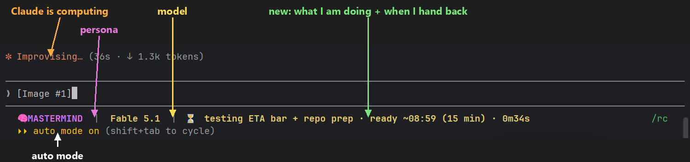
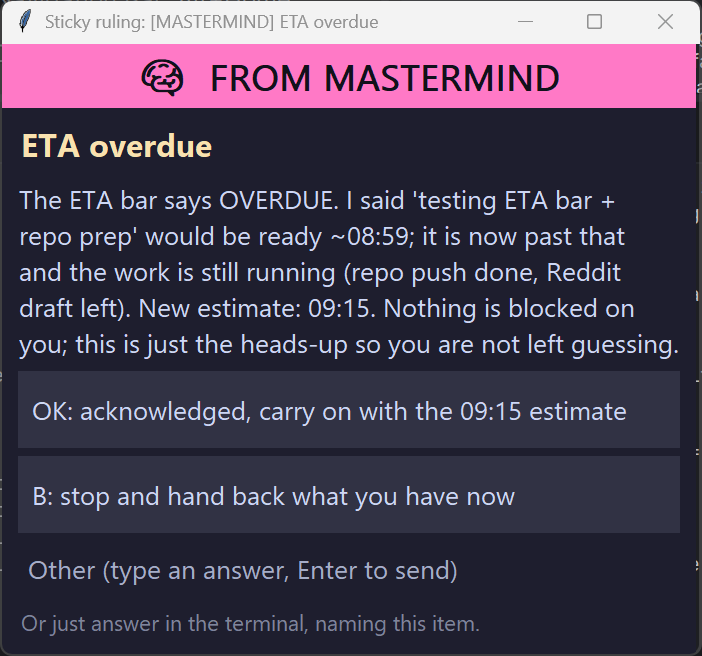

# eta-bar

**A status-line ETA for Claude Code.** While Claude works, the bar says what it is doing and when it expects to hand back. When it hands back, the bar says so.



## The problem

You start a long task, walk away, come back, and the terminal shows "Improvising... (4m 12s)". Working on what? For how much longer? Is it waiting on me? Across several Claude Code sessions in several projects the same question comes up all day: *when is the next interaction?*

## The fix

Three small hooks and one line in your status bar.

- **`⏳ testing the ETA bar · ready ~08:59 (15 min) · 0m34s`** while Claude works. The note and the time come from Claude itself: it is told at session start to post an ETA before any batch of work and to update it when a step finishes or the estimate slips.
- **`⏳ working · no ETA yet · 0m07s`** when it has not posted one yet.
- **`⏳ ... · OVERDUE 3 min (said ~08:59)`** in red when it blew the estimate.
- **`✅ ready for you · since 09:02`** when it hands back.

The elapsed counter ticks every 5 seconds even while a long tool call runs. One state file per session, so parallel sessions in different projects each show their own bar.

## Install

**As a plugin** (recommended, gets updates). Inside Claude Code:

```
/plugin marketplace add DrEvil-TitaniumHelix/eta-bar
/plugin install eta-bar@eta-bar
```

That wires the three hooks. Then put the segment in your status bar, in `~/.claude/settings.json`:

```json
"statusLine": {
  "type": "command",
  "command": "python \"~/.claude/plugins/cache/eta-bar/eta-bar/1.0.0/statusline.py\"",
  "refreshInterval": 5
}
```

(Use the full path to your home directory if your shell does not expand `~`. Already have a status line? Keep it and append the output of `python <plugin dir>/eta.py line <session_id>`; `session_id` is in the JSON Claude Code pipes to the status-line command.)

Restart Claude Code. Hooks load at session start.

**By hand.** Clone the repo anywhere, add the three hooks from `hooks/hooks.json` to your `settings.json` with the real path in place of `${CLAUDE_PLUGIN_ROOT}`, and point `statusLine` at `statusline.py`.

## How Claude knows to set an ETA

The `SessionStart` hook prints a one-paragraph duty into the session's context: before any batch of tool calls longer than a few seconds, run `python eta.py set "<what I'm doing>" <minutes>`, and update it as steps finish. Claude Code exports `CLAUDE_CODE_SESSION_ID` to the shell, which is how `set` finds the right session. If you want it stricter, copy that paragraph into your `CLAUDE.md`.

## Works with sticky-ruling

When the estimate slips, Claude can put the heads-up on screen as a [sticky ruling](https://github.com/DrEvil-TitaniumHelix/sticky-ruling): an always-on-top window with the new estimate and an acknowledge button, while the session keeps working.



## Optional: "ready for you" pop-up (Windows)

Create the empty file `~/.claude/eta/TOAST_ON` and a small always-on-top window appears at the top right when Claude hands back after 45 seconds or more of work. It never takes keyboard focus and closes itself when you type the next prompt. Off by default.

## Files

- `eta.py` - the whole thing, stdlib only. `python eta.py selftest` is the check.
- `statusline.py` - a minimal status line (directory | model | ETA) if you have none.
- `hooks/hooks.json` - the three hooks, for the plugin.

Tested on Windows 11 with Python 3.13. The bar and hooks are plain Python and should work on macOS and Linux; the pop-up is Windows only. MIT.

Companion: [sticky-ruling](https://github.com/DrEvil-TitaniumHelix/sticky-ruling), an always-on-top decision window that keeps the session working while you decide.
